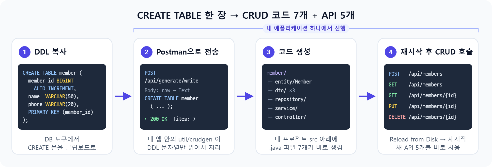
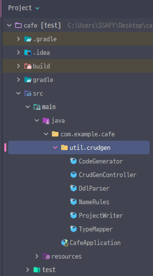
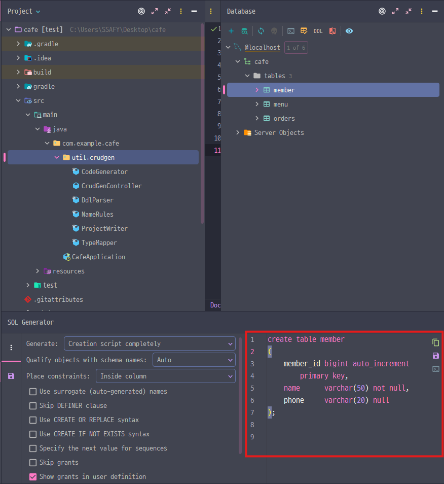
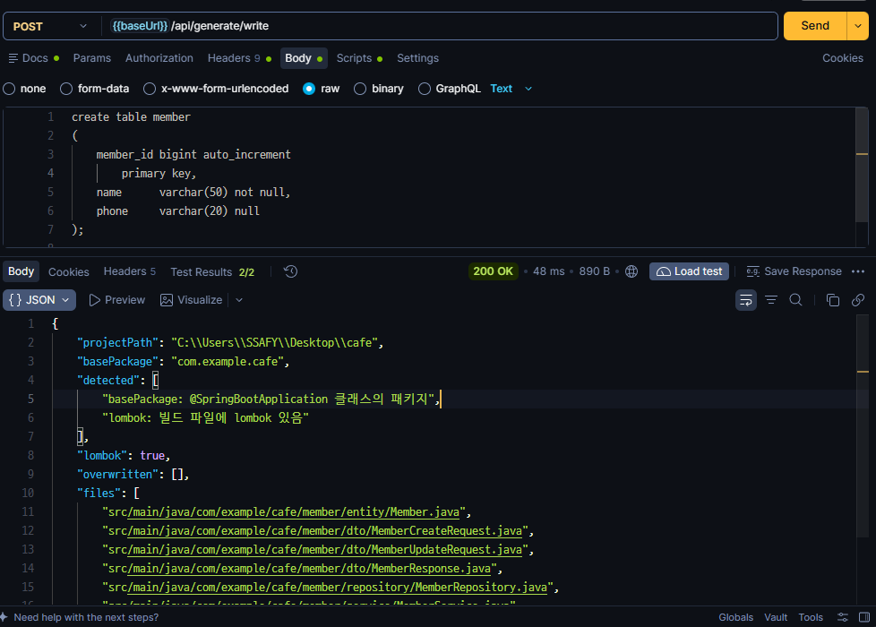
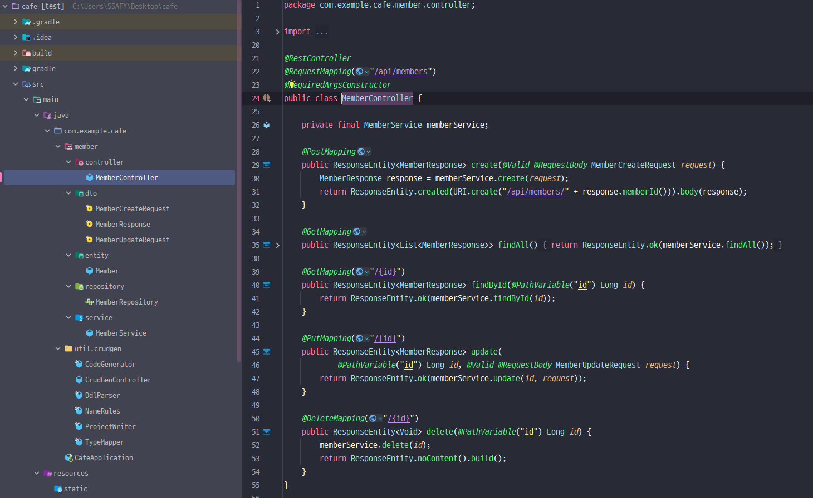
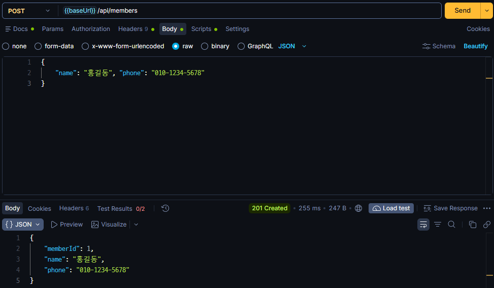
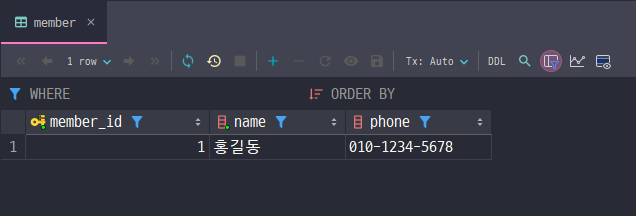

# CRUD Generator

> `CREATE TABLE` 한 장으로 Spring Boot CRUD 코드(Entity · DTO · Repository · Service · Controller)를 내 프로젝트에 바로 만들어주는 유틸

테이블이 하나 생길 때마다 Entity → DTO → Repository → Service → Controller를 같은 모양으로 다시 쓰는 일을 줄이기 위해 만들었습니다.
`util/crudgen` 폴더를 내 프로젝트에 복사하고, 애플리케이션을 실행한 뒤 Postman으로 DDL을 보내면 끝입니다.



1. **DDL 복사**: DB 도구에서 테이블의 `CREATE TABLE` 문을 복사합니다.
2. **Postman으로 전송**: `POST /api/generate/write`의 Body(raw → Text)에 붙여넣고 보냅니다. 내 앱에 함께 뜬 `util/crudgen`이 DDL 문자열만 읽어서 처리합니다.
3. **코드 생성**: 내 프로젝트 `src` 아래에 `member/` 패키지와 `.java` 파일 7개가 바로 생깁니다.
4. **재시작 후 CRUD 호출**: Reload from Disk → 애플리케이션 재시작 후 `/api/members` CRUD API 5개를 바로 쓸 수 있습니다.

---

## 목차

1. [동작 방식](#1-동작-방식)
2. [요구 사항](#2-요구-사항)
3. [설치](#3-설치)
4. [실행](#4-실행)
5. [사용 방법 (Postman)](#5-사용-방법-postman)
6. [생성 결과](#6-생성-결과)
7. [생성 규칙](#7-생성-규칙)
8. [예제: cafe DB](#8-예제-cafe-db)
9. [주의 사항](#9-주의-사항)
10. [트러블슈팅](#10-트러블슈팅)

---

## 1. 동작 방식

```
 ┌───────────── 내 프로젝트 (하나만 실행) ─────────────┐
 │                                                     │
 │  util/crudgen/  ◀── 이 폴더만 복사해서 넣음          │
 │       │                                             │
 │       │ POST /api/generate/write  (Body: CREATE TABLE)
 │       ▼                                             │
 │  member/                                            │
 │   ├─ entity/Member.java                             │
 │   ├─ dto/MemberCreateRequest.java                   │
 │   ├─ dto/MemberUpdateRequest.java                   │
 │   ├─ dto/MemberResponse.java                        │
 │   ├─ repository/MemberRepository.java               │
 │   ├─ service/MemberService.java                     │
 │   └─ controller/MemberController.java               │
 └─────────────────────────────────────────────────────┘
```

- **별도 서버가 필요 없습니다.** 내 애플리케이션을 실행하면 생성 API가 함께 열립니다.
- **DB에 접속하지 않습니다.** Body로 받은 DDL 문자열만 읽어서 코드를 만듭니다.
- 생성된 코드는 JPA만 사용하므로 **DB 종류와 상관없이** 동작합니다.
- 패키지와 Lombok 사용 여부는 **내 프로젝트를 보고 자동으로 정합니다.**

## 2. 요구 사항

| 항목 | 버전 |
|---|---|
| Java | 17 이상 |
| Spring Boot | 3.x / 4.x |
| 빌드 도구 | Gradle 또는 Maven |

생성된 코드가 컴파일·실행되려면 **내 프로젝트**에 아래 의존성이 필요합니다.
빠진 것이 있으면 생성 응답의 `warnings`에 알려줍니다.

```gradle
implementation 'org.springframework.boot:spring-boot-starter-web'        // Boot 4: spring-boot-starter-webmvc
implementation 'org.springframework.boot:spring-boot-starter-data-jpa'
implementation 'org.springframework.boot:spring-boot-starter-validation'
runtimeOnly    'com.mysql:mysql-connector-j'                             // 사용하는 DB 드라이버

// 선택: 있으면 @Getter, @RequiredArgsConstructor 를 쓰는 코드로, 없으면 생성자·getter 를 직접 쓴 코드로 생성
compileOnly 'org.projectlombok:lombok'
annotationProcessor 'org.projectlombok:lombok'
```

## 3. 설치

### 3-1. 저장소 가져오기

```bash
git clone https://github.com/king-dong-gun/crud-generator.git
```
또는 GitHub에서 **Fork** / **Code → Download ZIP**

### 3-2. `util/crudgen` 폴더를 내 프로젝트에 복사

저장소에서 필요한 건 `util/crudgen` 폴더 하나입니다.

```
crud-generator/src/main/java/com/example/demo/
├─ DemoApplication.java            데모 실행용 (복사하지 않음)
└─ util/crudgen/                   ← 이 폴더만 복사
   ├─ CrudGenController.java       POST /api/generate/write
   ├─ DdlParser.java               CREATE TABLE 해석
   ├─ TypeMapper.java              DB 타입 → Java 타입
   ├─ NameRules.java               이름 변환·충돌 검사
   ├─ CodeGenerator.java           7개 파일 코드 생성
   └─ ProjectWriter.java           프로젝트 폴더·패키지·Lombok 감지, 파일 쓰기
```

> 저장소 자체도 바로 실행되는 데모입니다. (`DemoApplication` 실행 → H2 메모리 DB, 포트 8080)
> 복사하기 전에 여기서 먼저 DDL을 보내 보며 동작을 확인할 수 있습니다. 데모에서 생성된 폴더(예: `member/`)는 커밋하지 마세요.

`@SpringBootApplication` 클래스가 있는 패키지 **아래**에 넣어야 Spring이 자동으로 찾습니다.

```
내 프로젝트
└─ src/main/java/com/example/cafe/
   ├─ CafeApplication.java          ← @SpringBootApplication
   └─ util/
      └─ crudgen/                   ← 여기에 붙여넣기
```




### 3-3. 패키지 선언 확인

IntelliJ 프로젝트 트리에 **붙여넣기(Ctrl+V)** 하면 `package` 선언이 자동으로 바뀝니다.
탐색기로 복사했다면 각 파일 첫 줄을 내 패키지에 맞게 고쳐주세요.

```java
package com.example.cafe.util.crudgen;   // ← 내 패키지 + .util.crudgen
```

파일에는 `package com.example.demo.util.crudgen;`이 적혀 있습니다. Spring Initializr 기본 패키지(`com.example.demo`)를 쓰는 프로젝트라면 고칠 필요가 없습니다.
6개 파일이 모두 같은 패키지라서 `import`는 고치지 않아도 됩니다.

`build.gradle`은 **수정하지 않아도 됩니다.** (추가 라이브러리 없이 `spring-boot-starter-web`만으로 동작)

### 3-4. (선택) 복사하지 않고 쓰기

이 저장소의 `DemoApplication`을 실행해 두고, 요청에 `projectPath`로 **대상 프로젝트 폴더**를 주면 그 프로젝트에 코드가 생성됩니다.
여러 프로젝트에 번갈아 쓸 때 편합니다.

```http
POST http://localhost:8080/api/generate/write?projectPath=C:/Users/me/IdeaProjects/cafe
Content-Type: text/plain

CREATE TABLE member (...);
```

- `projectPath`는 `build.gradle`(또는 `pom.xml`)이 있는 폴더입니다. 탐색기에서 복사한 `C:\Users\...` 형태도 됩니다.
- `basePackage`·`lombok`은 **대상 프로젝트**의 `@SpringBootApplication` 패키지와 빌드 파일을 보고 정합니다.
- 생성 후 새로고침·재시작은 **대상 프로젝트**에서 합니다. (데모 앱은 재시작할 필요 없음)
- 데모 앱이 8080 포트를 쓰므로, 대상 프로젝트를 동시에 실행하려면 포트를 다르게 두세요.

## 4. 실행

1. DB 접속 정보가 들어 있는 내 프로젝트를 평소처럼 실행합니다. (`CafeApplication` 실행)
2. 콘솔에 `Tomcat started on port ...`가 보이면 준비 완료입니다.

```yaml
# src/main/resources/application.yml (예시)
server:
  port: 8081
spring:
  datasource:
    url: jdbc:mysql://localhost:3306/cafe
    username: root
    password: 1234
  jpa:
    hibernate:
      ddl-auto: none      # 테이블은 DB에 이미 있으므로 JPA가 건드리지 않게
    show-sql: true
```

> 생성 API는 **같은 PC(localhost)에서 온 요청만** 받습니다.

## 5. 사용 방법 (Postman)

### 5-1. DB에 테이블 만들기

```sql
CREATE DATABASE cafe;
USE cafe;

CREATE TABLE member (
  member_id BIGINT NOT NULL AUTO_INCREMENT,
  name      VARCHAR(50) NOT NULL,
  phone     VARCHAR(20),
  PRIMARY KEY (member_id)
);
```

### 5-2. DDL 복사

| 도구 | 방법 |
|---|---|
| IntelliJ Database | 테이블 우클릭 → **SQL Scripts → Generate DDL to Clipboard** (`Ctrl+Alt+G`) |
| MySQL Workbench | 테이블 우클릭 → **Copy to Clipboard → Create Statement** |
| SQL | `SHOW CREATE TABLE member;` 결과 복사 |




### 5-3. 요청 보내기

| 항목 | 값 |
|---|---|
| Method | `POST` |
| URL | `http://localhost:8081/api/generate/write` (포트는 내 프로젝트 포트) |
| Body | **raw → Text** 에 복사한 DDL 붙여넣기 |

> 저장소의 `crud-generator.postman_collection.json`을 **Import (Ctrl+O)** 하면 예시 요청이 준비되어 있습니다.
> 컬렉션 **Variables**에서 `baseUrl`을 내 프로젝트 주소(예: `http://localhost:8081`)로 바꾸고 저장(Ctrl+S)하세요.

**선택 쿼리 파라미터**

| 파라미터 | 기본값 | 설명 |
|---|---|---|
| `basePackage` | `@SpringBootApplication` 패키지 | 코드를 만들 패키지를 직접 지정 |
| `lombok` | 빌드 파일에 lombok 있으면 `true` | `false`면 생성자·getter를 직접 생성 |
| `overwrite` | `false` | `true`면 이미 있는 파일을 덮어씀 (직접 고친 내용은 사라짐) |
| `projectPath` | 실행 중인 프로젝트 폴더 | 자동으로 못 찾을 때만 절대 경로로 지정 (`C:/Users/me/IdeaProjects/cafe`처럼 `/` 사용) |

### 5-4. 응답 확인

```json
{
  "projectPath": "C:\\Users\\me\\IdeaProjects\\cafe",
  "basePackage": "com.example.cafe",
  "detected": [
    "basePackage: @SpringBootApplication 클래스의 패키지",
    "lombok: 빌드 파일에 lombok 있음"
  ],
  "lombok": true,
  "overwritten": [],
  "files": [
    "src/main/java/com/example/cafe/member/entity/Member.java",
    "src/main/java/com/example/cafe/member/dto/MemberCreateRequest.java",
    "src/main/java/com/example/cafe/member/dto/MemberUpdateRequest.java",
    "src/main/java/com/example/cafe/member/dto/MemberResponse.java",
    "src/main/java/com/example/cafe/member/repository/MemberRepository.java",
    "src/main/java/com/example/cafe/member/service/MemberService.java",
    "src/main/java/com/example/cafe/member/controller/MemberController.java"
  ],
  "warnings": []
}
```



| 상태 코드 | 의미 |
|---|---|
| `200` | 생성 완료. `files`에 만들어진 파일 목록 |
| `400` | 잘못된 입력. `error`에 이유 (PK 없음, 지원하지 않는 타입, 복합 PK 등) |
| `403` | localhost가 아닌 곳에서 보낸 요청 |
| `409` | 같은 파일이 이미 있음. **하나도 쓰지 않음** (`overwrite=true`로 덮어쓰기) |

### 5-5. 새로고침 → 재시작 → CRUD 호출

1. IntelliJ에서 프로젝트 우클릭 → **Reload from Disk** → `member/` 아래에 7개 파일이 보입니다.



2. 애플리케이션 **재시작** (새로 생긴 Controller를 등록하기 위해)
3. 생성된 API 호출 (Body는 **raw → JSON**, 키는 camelCase)

```http
POST http://localhost:8081/api/members
Content-Type: application/json

{ "name": "홍길동", "phone": "010-1234-5678" }
```



DB에도 저장된 것을 확인할 수 있습니다.



## 6. 생성 결과

테이블 하나당 7개 파일, API 5개가 만들어집니다.

```
{basePackage}/{테이블}/
├─ controller/{Class}Controller.java
├─ dto/{Class}CreateRequest.java      등록 요청 (+ @NotBlank, @Size 검증)
├─ dto/{Class}UpdateRequest.java      수정 요청
├─ dto/{Class}Response.java           응답
├─ entity/{Class}.java
├─ repository/{Class}Repository.java  JpaRepository
└─ service/{Class}Service.java
```

| Method | URL | 설명 | 응답 |
|---|---|---|---|
| POST | `/api/members` | 등록 | 201 + `Location` 헤더 |
| GET | `/api/members` | 목록 | 200 |
| GET | `/api/members/{id}` | 단건 | 200 / 없으면 404 |
| PUT | `/api/members/{id}` | 수정 | 200 |
| DELETE | `/api/members/{id}` | 삭제 | 204 |

<details>
<summary>생성 코드 예시: Member.java</summary>

```java
@Entity
@Table(name = "member")
@Getter
@NoArgsConstructor(access = AccessLevel.PROTECTED)
public class Member {

    @Id
    @GeneratedValue(strategy = GenerationType.IDENTITY)
    @Column(name = "member_id")
    private Long memberId;

    @Column(name = "name", nullable = false, length = 50)
    private String name;

    @Column(name = "phone", length = 20)
    private String phone;

    public Member(String name, String phone) {
        this.name = name;
        this.phone = phone;
    }

    public void update(String name, String phone) {
        this.name = name;
        this.phone = phone;
    }
}
```
</details>

<details>
<summary>생성 코드 예시: MemberCreateRequest.java</summary>

```java
public record MemberCreateRequest(
        @NotBlank @Size(max = 50) String name,
        @Size(max = 20) String phone
) {

    public Member toEntity() {
        return new Member(name, phone);
    }
}
```
</details>

## 7. 생성 규칙

### 이름

| DB | Java |
|---|---|
| 테이블 `member_order` | 클래스 `MemberOrder` · 패키지 `memberorder` · URL `/api/member-orders` |
| 컬럼 `user_name`, `USER_NAME` | 필드 `userName` |
| 자바 예약어 컬럼 `class` | 필드 `classValue` (`@Column(name = "class")`로 매핑 유지) |

### 타입

| DB 타입 | Java |
|---|---|
| VARCHAR, VARCHAR2, NVARCHAR, CHAR, TEXT, CLOB | `String` |
| INT, INTEGER, SMALLINT | `Integer` (INT UNSIGNED → `Long`) |
| BIGINT, SERIAL, BIGSERIAL | `Long` |
| TINYINT(1), BIT, BOOLEAN | `Boolean` |
| DECIMAL, NUMERIC | `BigDecimal` (+ precision, scale) |
| NUMBER(p) / NUMBER(p, s) | p≤9 `Integer`, p≤18 `Long` / s>0 `BigDecimal` |
| FLOAT / DOUBLE | `Float` / `Double` |
| DATE | `LocalDate` |
| DATETIME, TIMESTAMP | `LocalDateTime` |
| TIMESTAMPTZ | `OffsetDateTime` |
| TIME | `LocalTime` |
| UUID | `UUID` |
| BLOB, BINARY, BYTEA | `byte[]` |

### 레이어

- **Entity**: 기본 생성자 `protected`, setter 대신 `update(...)` 메서드
- **DTO**: `record`. 등록/수정 요청 분리 (AUTO_INCREMENT PK는 등록에서, PK는 수정에서 제외)
- **Service**: 클래스에 `@Transactional(readOnly = true)`, 쓰기 메서드만 `@Transactional`
- **Controller**: 요청 DTO에 `@Valid`

### 지원 DB (DDL 문법)

MySQL · MariaDB · PostgreSQL · Oracle · H2 · SQLite · SQL Server

DDL에서 읽는 정보: 테이블명(스키마명·백틱·대괄호 제거), 컬럼명, 타입, `NOT NULL`, `PRIMARY KEY`, `AUTO_INCREMENT` / `IDENTITY` / `SERIAL`, `COMMENT`
`UNIQUE`, `INDEX`, `FOREIGN KEY` 같은 제약 조건 줄은 건너뜁니다.

## 8. 예제: cafe DB

```sql
CREATE TABLE member (member_id BIGINT AUTO_INCREMENT PRIMARY KEY, name VARCHAR(50) NOT NULL, phone VARCHAR(20));
CREATE TABLE menu   (menu_id BIGINT AUTO_INCREMENT PRIMARY KEY, name VARCHAR(50) NOT NULL, price INT NOT NULL);
CREATE TABLE orders (order_id BIGINT AUTO_INCREMENT PRIMARY KEY, member_id BIGINT NOT NULL, menu_id BIGINT NOT NULL,
                     quantity INT NOT NULL, ordered_at DATETIME);
```

테이블마다 DDL을 한 번씩 보내면 (총 3번) 아래처럼 생성됩니다.

```
com/example/cafe/
├─ member/   →  /api/members
├─ menu/     →  /api/menus
└─ orders/   →  /api/orders
```

## 9. 주의 사항

- **배포 전에는 `util/crudgen` 폴더를 지우세요.** localhost 요청만 받지만, 개발용 도구이므로 운영 코드에 남길 이유가 없습니다.
- **`order`, `user` 같은 SQL 예약어 테이블명**은 피하는 것이 좋습니다. (`orders`, `users`)
- **`DEFAULT` 값이 있는 컬럼** (예: `created_at DATETIME DEFAULT CURRENT_TIMESTAMP`)은 요청에서 값을 빼면 JPA가 `NULL`을 넣어 DB 기본값이 적용되지 않습니다. 필요하면 생성 후 요청 DTO에서 해당 필드를 지우거나 `@Column(insertable = false, updatable = false)`를 붙이세요.
- **`ddl-auto`는 `none`을 권장합니다.** `validate`는 `TINYINT(1)` ↔ `Boolean` 같은 타입 차이로 실패할 수 있습니다.

### 아직 지원하지 않는 것

- 복합 PK (`@EmbeddedId`)
- 연관관계 (`FOREIGN KEY` → `@ManyToOne`)
- 여러 `CREATE TABLE`을 한 번에 보내기
- 페이징 조회

## 10. 트러블슈팅

<details>
<summary>증상별 원인과 해결 방법 (클릭해서 펼치기)</summary>

| 증상 | 원인 / 해결 |
|---|---|
| JSON이 아닌 `HTTP Status 400 – Bad Request` HTML 페이지 | URL에 `\`나 치환 안 된 `{{변수}}`가 들어감. 기본 사용법에서는 쿼리 없이 `/api/generate/write`만 쓰고, `projectPath`는 `/`로 구분 |
| `프로젝트 폴더를 찾지 못했습니다` | jar로 실행했거나 폴더 구조가 특이한 경우. `projectPath` 쿼리 파라미터로 직접 지정 |
| `projectPath 폴더가 없습니다` | 경로 오타. `build.gradle` 우클릭 → **Copy Path → Absolute Path**로 확인 |
| `Spring 프로젝트 폴더가 아닌 것 같습니다` | `projectPath`가 `build.gradle`이 있는 **최상위 폴더**가 아님 |
| `record`, `switch` 관련 컴파일 에러 | 프로젝트 JDK가 17 미만. **File → Project Structure → SDK**와 Gradle JVM을 17 이상으로 |
| Spring Security 사용 시 401 / 403 | `/api/generate/**`를 `permitAll()` 하고 CSRF 예외 처리 (개발 중에만) |
| `@SpringBootApplication 클래스를 찾지 못했습니다` | `basePackage` 쿼리 파라미터로 직접 지정 |
| `409 Conflict` | 이미 생성된 파일이 있음. `overwrite=true`로 다시 보내기 |
| Postman에서 404 | `util/crudgen`이 `@SpringBootApplication` 패키지 **바깥**에 있음 |
| 404 응답의 `path`가 `/api/generate/write%0A` | URL 끝에 줄바꿈이 붙음 (붙여넣기 때 같이 들어감). URL 칸 끝에서 Backspace로 지우기 |
| 생성 후 `/api/members`가 404 | 애플리케이션 재시작 필요 |
| 실행 시 DB 설정 에러 | 파일 이름 확인: `application.yml` (`aplication.yml` 오타 주의) |
| `No database selected` | `USE cafe;` 먼저 실행하거나 `cafe.member`처럼 DB명 붙이기 |
| `Connection refused` (DB) | MySQL 서버가 꺼져 있음. Docker Desktop 실행 후 `docker start mysql` |
| CRUD 요청 시 400 | Body를 **form-data가 아닌 raw → JSON**으로, 키는 camelCase(`userName`)로 |

</details>
